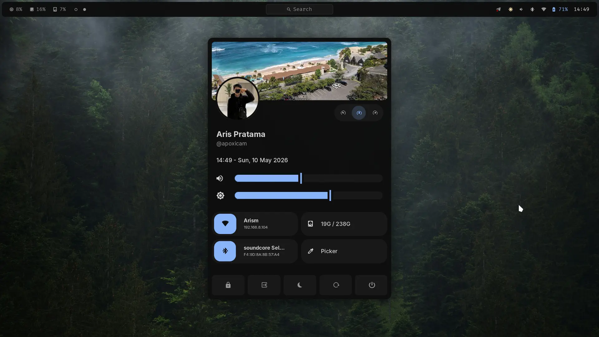
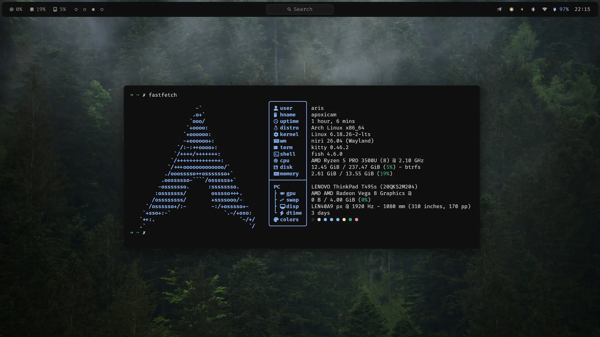
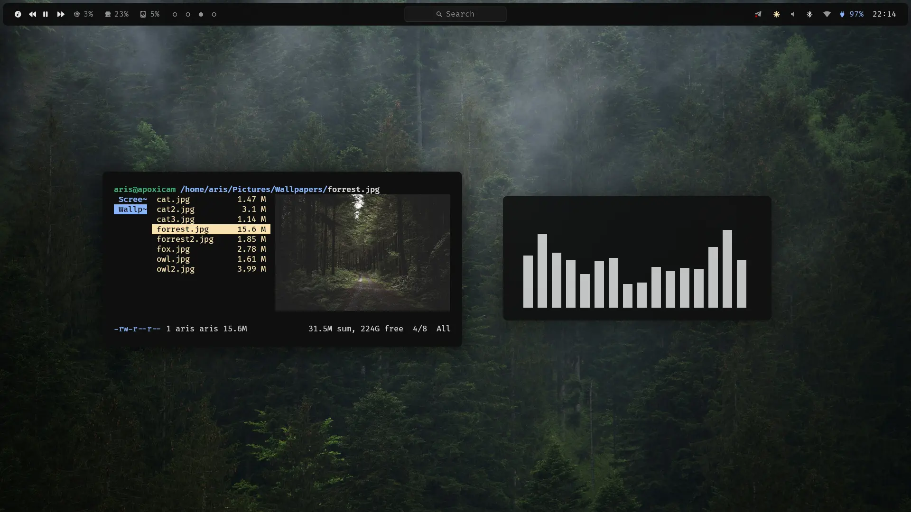
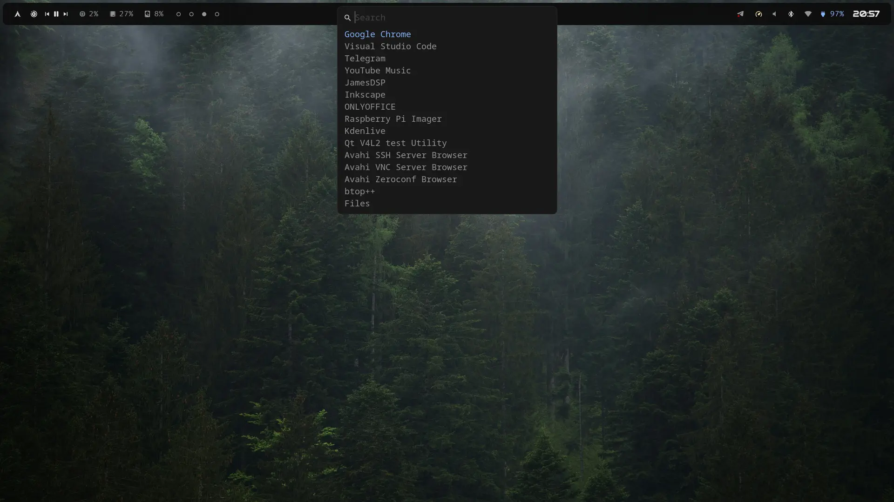
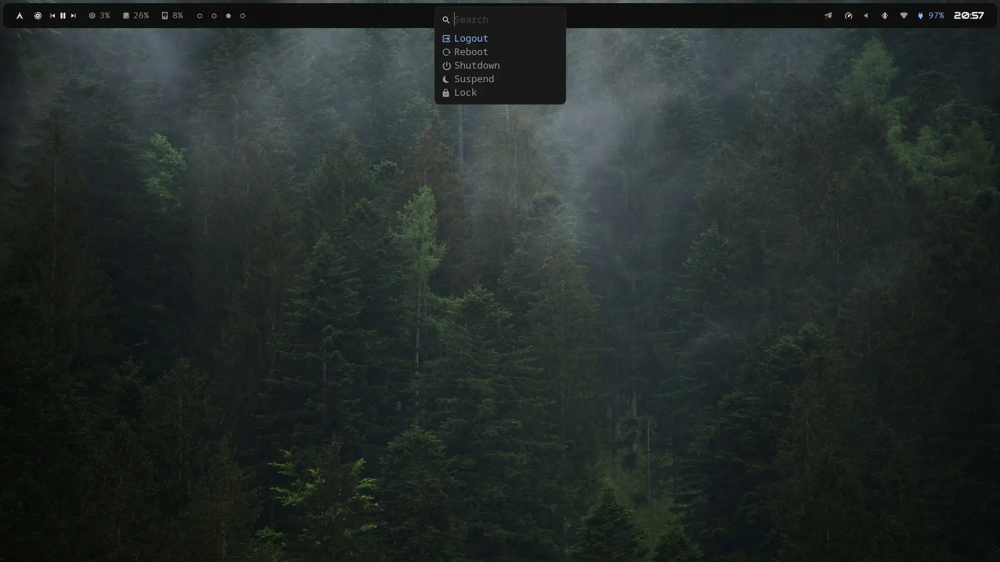
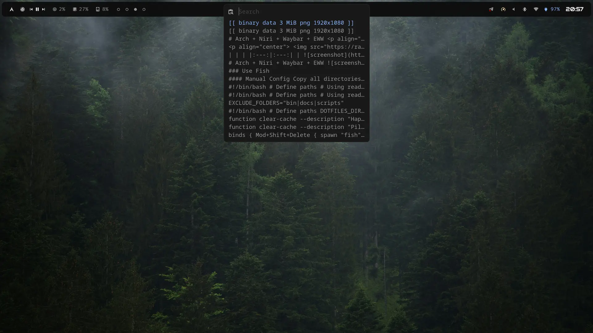
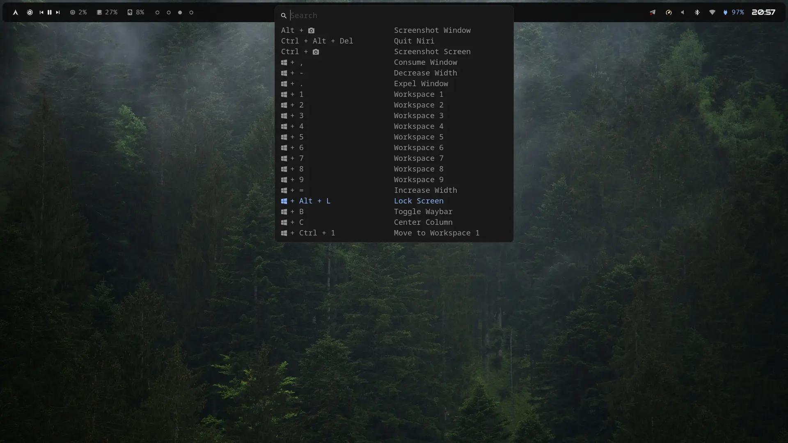
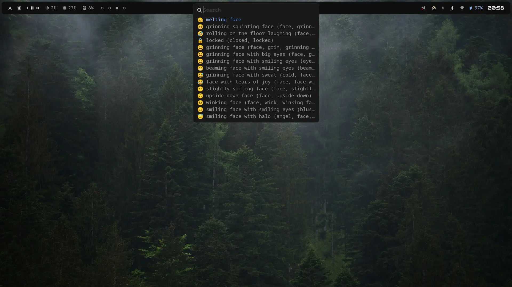

# Arch + Niri + Waybar + EWW
<p align="center">
  
  
  
  
  
  
  
  
</p>

After install arch minimal with archinstall. Using systemd-boot + UKI, btrfs, tuned, and ufw

## Setup Home Directory

```bash
sudo pacman -S xdg-user-dirs && xdg-user-dirs-update
```

## Install Paru

```bash
sudo pacman -S --needed base-devel git
git clone https://aur.archlinux.org/paru.git && cd paru
makepkg -si
```

## Install Prerequisites

```bash
paru -S fish eza \
  less micro btop fastfetch \
  brightnessctl cliphist wl-clipboard \
  niri mako libnotify waybar hyprpicker fuzzel rofimoji \
  polkit-gnome \
  kitty nautilus totem loupe \
  wf-recorder slurp \
  gst-plugins-good \
  gst-plugins-bad \
  gst-plugins-ugly \
  gst-libav \
  ffmpegthumbnailer \
  samba gvfs-smb \
  freerdp \
  xwayland-satellite \
  podman-compose \
  ttf-firacode-nerd \
  swaylock swaybg \
  bluetui nmtui-go \
  eww ryzenadj
```

> **Note:** `eww` and `ryzenadj` is optional.

## Configuration

### Use Fish
```
chsh -s /usr/bin/fish
```
### Config Installation
#### Manual
Copy all directories and files to the exact same paths as in this repo.

#### Sync
We can create symlink this dots to .config

> This will replace your current setup to the symlink

```
./sync
```

### I use Starship
Don't forget to install **Starship** prompt:

```bash
curl -sS https://starship.rs/install.sh | sh
```

## Btrfs + Snapper

Install Snapper:

```bash
paru -S snapper
```

Create a manual-only config for root:

```bash
sudo snapper -c root create-config /
```

Edit `/etc/snapper/configs/root` and set:

```
TIMELINE_CREATE="no"
TIMELINE_CLEANUP="no"
```

Disable automatic snapshot timers:

```bash
sudo systemctl stop snapper-timeline.timer
sudo systemctl disable snapper-timeline.timer
sudo systemctl stop snapper-cleanup.timer
sudo systemctl disable snapper-cleanup.timer
```

### Snapshot Commands

| Command | Description |
|---------|-------------|
| `snap` | Create a snapshot |
| `snap-list` | View the snapshot list |
| `snap-del` | Delete a snapshot |

## Tips

### Xorg-based Apps

To run Xorg-based apps under Wayland, install:

```bash
sudo pacman -S xwayland-satellite
```

To run Xorg-based apps under Wayland that need to be root:
```bash
paru -S xorg-xhost
```
Then
```bash
xhost +si:localuser:root
```
Make it automatic in niri auto start
```kdl
spawn-at-startup "xhost" "+si:localuser:root"
```

### Samba

Edit the Samba config:

```bash
nano /etc/samba/smb.conf
```

Add the following:

```ini
[global]
   workgroup = WORKGROUP
   server string = Arch Samba
   security = user
   map to guest = Bad User

[Public]
   path = /home/YourUsername/Public
   writable = yes
   guest ok = yes
   guest only = yes
   force user = YourUsername
```

Add and activate a Samba user:

```bash
sudo smbpasswd -a YourUsername
sudo smbpasswd -e YourUsername
```

Allow Samba through the firewall:

```bash
sudo ufw allow 137,138/udp
sudo ufw allow 139,445/tcp
sudo ufw reload
```

### Samba Commands

| Command | Description |
|---------|-------------|
| `share-on` | Share the Public directory |
| `share-off` | Stop sharing the Public directory |

### WiFi Hotspot

Start/stop with `hotspot` / `hotspot-off` (functions in `.config/fish/functions/`). First run prompts SSID + WPA2 password; later runs reuse saved values. Hotspot uses `ipv4.method shared`, DHCP served by `dnsmasq`, uplink follows the default route (wwan).

One-time firewall rules (needed with `ufw`):

```bash
sudo ufw allow in on wlp1s0 to any port 67 proto udp comment 'hotspot dhcp'
sudo ufw allow in on wlp1s0 to any port 53 proto udp comment 'hotspot dns'
sudo ufw allow in on wlp1s0 to any port 53 proto tcp comment 'hotspot dns tcp'
sudo ufw route allow in on wlp1s0 comment 'hotspot forward'
sudo ufw reload
```

IPv4 forwarding:

```bash
echo 'net.ipv4.ip_forward=1' | sudo tee /etc/sysctl.d/99-hotspot.conf
sudo sysctl --system
```

DNS workaround: clients (`10.42.0.180`) get no answer from dnsmasq on `10.42.0.1:53`, so redirect client DNS to `8.8.8.8`:

```bash
sudo iptables -t nat -A PREROUTING -i wlp1s0 -p udp --dport 53 -j DNAT --to-destination 8.8.8.8:53
sudo iptables -t nat -A PREROUTING -i wlp1s0 -p tcp --dport 53 -j DNAT --to-destination 8.8.8.8:53
```

Run after each reboot (rules are not persistent). Verify from the client: open `http://1.1.1.1` (IP/routing) and a domain name (DNS). On the host:

```bash
nmcli -f NAME,DEVICE,STATE con show --active
sudo cat /proc/net/nf_conntrack | grep 10.42.0
```

### Windows VM

Rename and copy `win11.iso` to `~/Documents/iso`, then:

```bash
cd Documents/windows11/ && podman-compose up -d && podman-compose logs -f
```

Wait for the installation to finish, then debloat it.

To manage the Windows VM, press `Meta + Space` and search:
- **Start Win** — start Windows and FreeRDP
- **Stop Win** — stop the service

## Use Micro in Ranger
```
set -Ux EDITOR micro
set -Ux VISUAL micro
```

## Keyboard Shortcuts

| Shortcut | Action |
|----------|--------|
| `Meta + T` | Open Kitty terminal |
| `Meta + E` | Open Nautilus file manager |
| `Meta + Space` | Open app launcher |
| `Meta + Shift + /` | View shortcut list |
| `Meta + X` | Open power menu |
| `Meta + S` | Toggle Record screen |
| `Meta + Shift + Space` | Open eww dashbord |

> I no longer use eww dashboard but i'll keep it here.
